<p align="center">
  
</p>

<h1 align="center">Image Upload</h1>

<p align="center">
  A Flutter app (Android and iOS) that uploads photos to <b>Cloudinary</b>, saves
  their details in <b>Cloud Firestore</b>, and shows every image in a gallery that
  updates <b>live</b>, like a chat app. State is managed with <b>BLoC</b>.
</p>

<p align="center">
  
  
  
  
  
</p>

---

## Contents

- [What the app does](#what-the-app-does)
- [Screenshots](#screenshots)
- [Tech stack](#tech-stack)
- [How it works](#how-it-works)
  - [Cloudinary: image storage](#cloudinary-image-storage)
  - [Firebase: Cloud Firestore](#firebase-cloud-firestore)
  - [BLoC: state management](#bloc-state-management)
  - [Routing with go_router](#routing-with-go_router)
  - [Why the Images tab updates live](#why-the-images-tab-updates-live)
  - [How deletes behave](#how-deletes-behave)
- [Folder structure](#folder-structure)
- [UI and animation](#ui-and-animation)
- [Getting started](#getting-started)
- [Tests](#tests)

## What the app does

1. Pick a photo from the gallery or take one with the camera.
2. Give it a reference name and tap **Submit**.
3. The photo goes to **Cloudinary**; its link and name are saved to
   **Cloud Firestore**.
4. The **Images** tab lists every upload, oldest first. New images appear and
   deleted ones disappear on their own, with no refresh, even when the change
   is made by hand in the Firebase console.

## Screenshots

All screenshots are from the iOS Simulator and live in
[`screenshots/`](screenshots).

### Launch

<table>
  <tr>
    <td align="center"><br><sub>App icon on the home screen</sub></td>
    <td align="center"><br><sub>Native splash</sub></td>
    <td align="center"><br><sub>Animated splash and progress line</sub></td>
    <td align="center">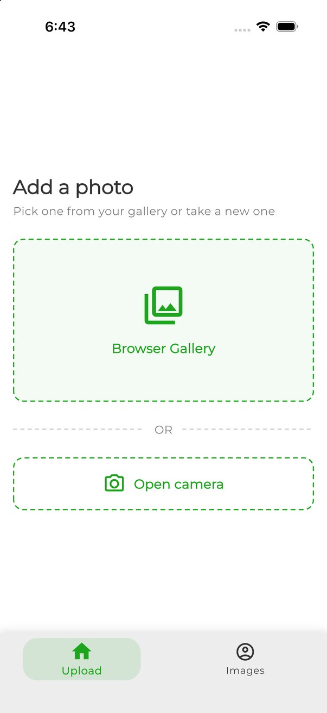<br><sub>Upload tab: pick a source</sub></td>
  </tr>
</table>

### Uploading

<table>
  <tr>
    <td align="center">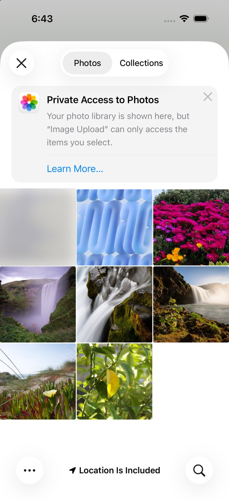<br><sub>System photo picker</sub></td>
    <td align="center">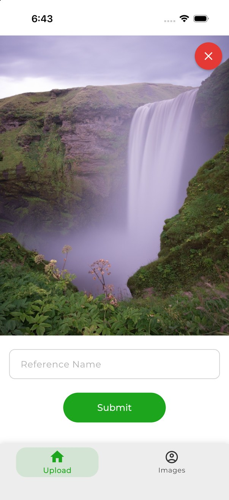<br><sub>Preview</sub></td>
    <td align="center">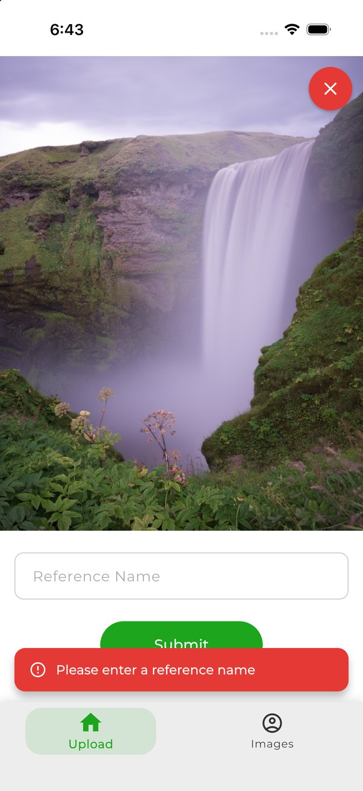<br><sub>Empty name: error toast</sub></td>
    <td align="center">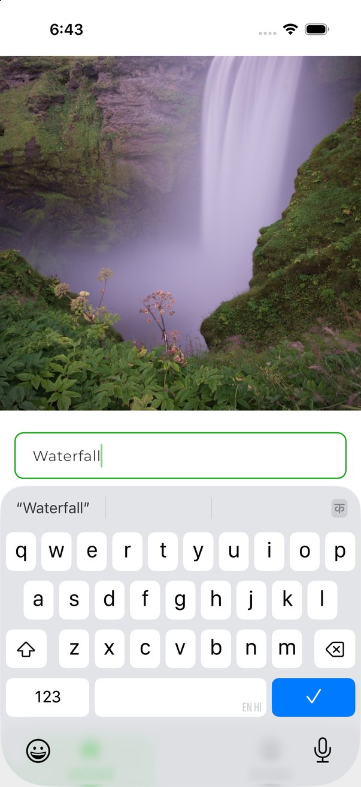<br><sub>Reference name entered</sub></td>
  </tr>
  <tr>
    <td align="center">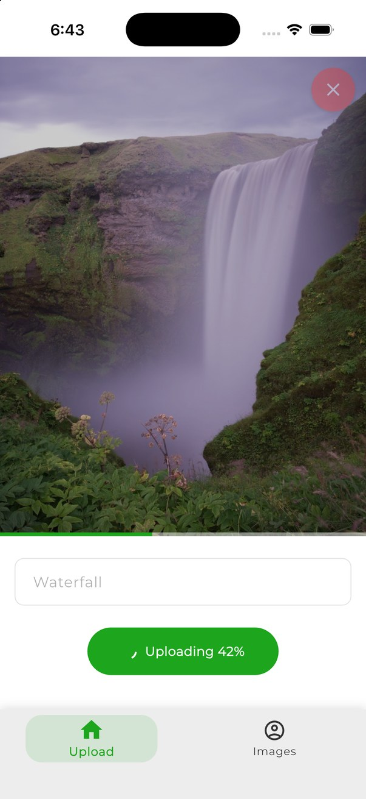<br><sub>Real upload progress (42%)</sub></td>
    <td align="center">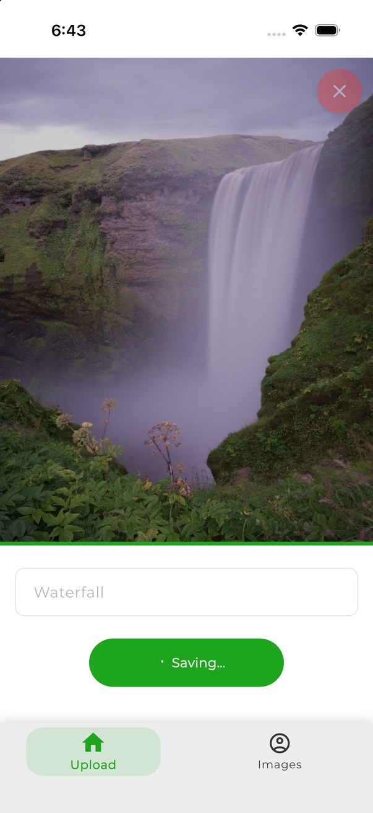<br><sub>Saving to Firestore</sub></td>
    <td align="center">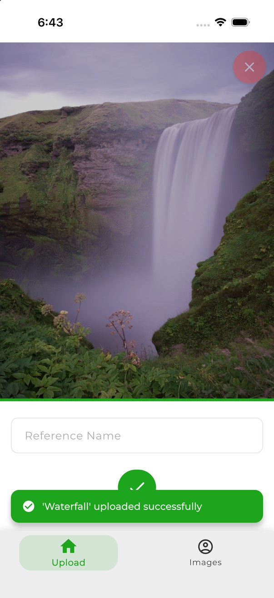<br><sub>Success check and toast</sub></td>
    <td align="center">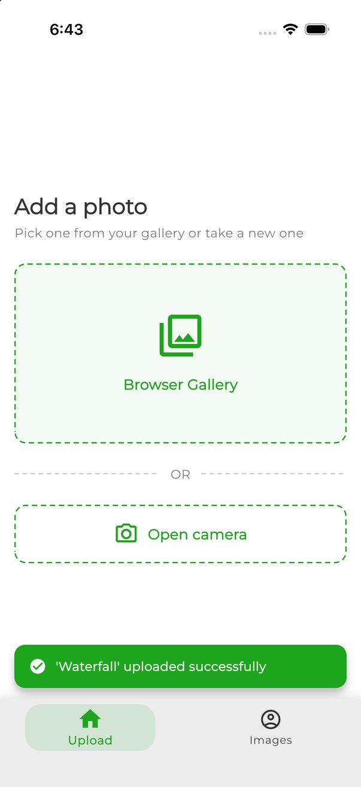<br><sub>Back on the Upload tab</sub></td>
  </tr>
</table>

### Images tab (live)

<table>
  <tr>
    <td align="center">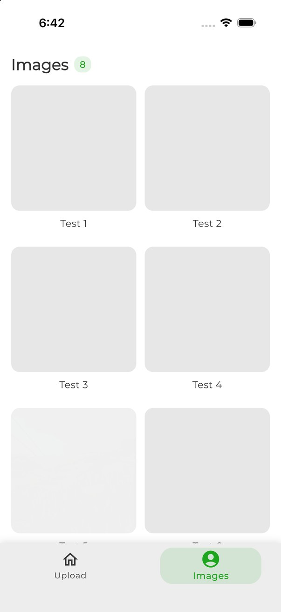<br><sub>Skeleton loading</sub></td>
    <td align="center">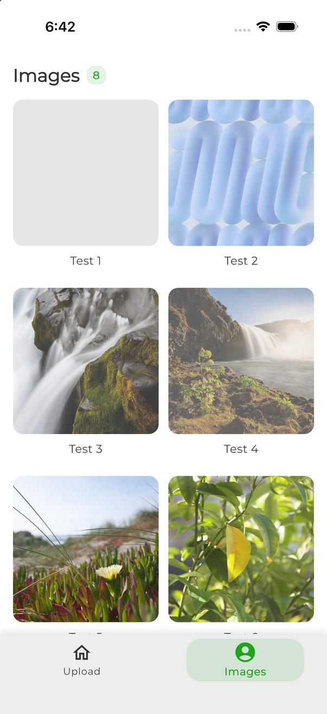<br><sub>Photos fading in</sub></td>
    <td align="center">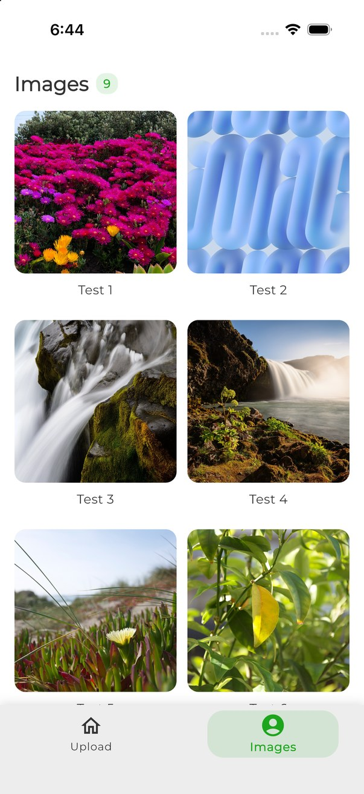<br><sub>Gallery with count</sub></td>
    <td align="center">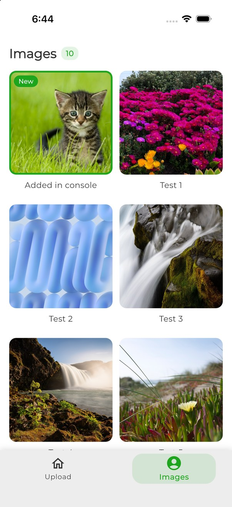<br><sub>Doc added in console: pops in as "New"</sub></td>
  </tr>
  <tr>
    <td align="center">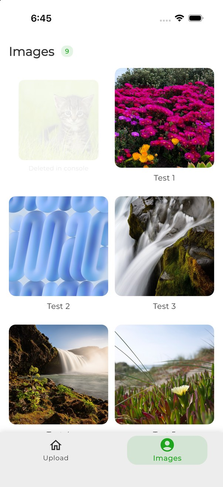<br><sub>Doc deleted in console: fades out</sub></td>
    <td align="center"><br><sub>Full-screen viewer</sub></td>
    <td></td>
    <td></td>
  </tr>
</table>

## Tech stack

| Area | What's used |
|---|---|
| Framework | Flutter 3.44 (Dart 3.12), Android and iOS |
| State management | **BLoC**: `flutter_bloc`, `bloc`, `bloc_concurrency`, `equatable` (events and states only, no Cubit) |
| Image storage | **Cloudinary**, upload through an unsigned preset with `http` |
| Database | **Firebase**: `firebase_core`, `cloud_firestore` (live `snapshots()` stream) |
| Navigation | `go_router` (`StatefulShellRoute.indexedStack`, redirect guard) |
| Images | `image_picker` (gallery and camera), `cached_network_image` |
| Look | Montserrat via `google_fonts`, brand green `#1DA51D` |
| Tooling (dev only) | `bloc_test`, `mocktail`, `flutter_launcher_icons`, `flutter_native_splash` |

## How it works

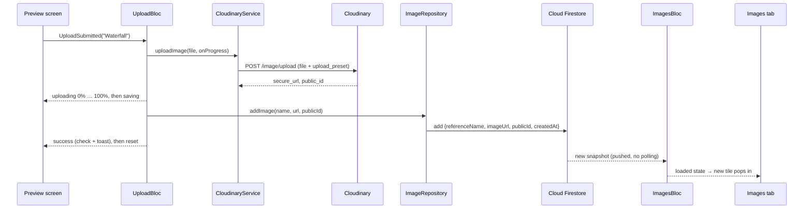

### Cloudinary: image storage

Cloudinary stores the image files and serves them from its CDN.

* **Unsigned upload preset.** The app only knows the cloud name (`fqfo8jif`)
  and the unsigned preset (`nap_images`), both in
  [`lib/core/app_config.dart`](lib/core/app_config.dart). There is **no API
  key or secret in the app**; an unsigned preset doesn't need one.
* **Request.** `CloudinaryService.uploadImage` sends a multipart
  `POST https://api.cloudinary.com/v1_1/fqfo8jif/image/upload` with
  `file=<image bytes>` and `upload_preset=nap_images`. Uploads land in the
  `nap_images` folder.
* **Response.** The app keeps `secure_url` (shown in the grid) and `public_id`
  (stored so the asset can be found later).
* **Progress.** The service wraps the multipart body stream and reports the
  share of bytes sent, which drives the "Uploading 42%" button and the bar
  under the photo.
* **Errors.** A non-200 response becomes a readable `CloudinaryException`
  (for example "Upload failed (400): Upload preset not found").

### Firebase: Cloud Firestore

Firestore holds one small document per image and pushes changes to the app.

* **Project:** `testnapproject`. Config is generated by
  `flutterfire configure` into [`lib/firebase_options.dart`](lib/firebase_options.dart)
  (plus `google-services.json` and `GoogleService-Info.plist`).
* **Collection `images`** (auto IDs):

  | Field | Type | Notes |
  |---|---|---|
  | `referenceName` | string | trimmed, required |
  | `imageUrl` | string | Cloudinary `secure_url` |
  | `publicId` | string | Cloudinary `public_id` |
  | `createdAt` | timestamp | `FieldValue.serverTimestamp()` |

* **Reading:** `ImageRepository.watchImages()` is
  `collection('images').orderBy('createdAt').snapshots()`, so the list is
  oldest first and every add or delete arrives as a new snapshot.
* **Rules:** [`firestore.rules`](firestore.rules) is open test mode, scoped to
  `images` only: anyone can read and delete; create needs all four fields and a
  non-empty string `referenceName`; updates are denied; every other path is
  denied.

### BLoC: state management

All state lives in two blocs that use **events and states** (no Cubit
anywhere). Widgets only dispatch events and render states; they never call
Cloudinary or Firestore directly. All states and events extend `Equatable`.

**`UploadBloc`** ([`lib/blocs/upload`](lib/blocs/upload))

| Event | What happens |
|---|---|
| `ImagePickRequested(source)` | opens the picker (quality 80, max width 1600); cancel changes nothing; a pick moves to `picked` |
| `ImageCleared()` | back to `initial` |
| `UploadSubmitted(name)` | blank name → `failure` "Please enter a reference name"; otherwise `uploading` with progress → Cloudinary → Firestore → `success` (held 0.9 s for the check mark) → `initial`. Any error → `failure` with a readable message, keeping the photo and the typed name |

State: `status` (`initial`, `picked`, `uploading`, `success`, `failure`),
`pickedFile`, `progress`, `errorMessage`, `lastUploadedName`.
`UploadSubmitted` uses `droppable()` from `bloc_concurrency`, so a double tap
can't upload twice.

**`ImagesBloc`** ([`lib/blocs/images`](lib/blocs/images))

* One event, `ImagesSubscriptionRequested`, handled with
  `emit.forEach(repository.watchImages(), …)`.
* State: `status` (`loading`, `loaded`, `failure`), `images`, `errorMessage`.
* Created **once** in `main.dart`, above the router, so the Firestore listener
  stays open for the whole session.

**Where things are wired:** `main.dart` initialises Firebase, provides
`CloudinaryService` and `ImageRepository` with `RepositoryProvider`s, and
creates both blocs in a `MultiBlocProvider` above `MaterialApp.router`.
Navigation happens only in the UI, from `BlocListener`s; blocs never import
`go_router`.

### Routing with go_router

| Path | Screen | Notes |
|---|---|---|
| `/splash` | `SplashScreen` | first screen; moves on to `/upload` |
| `/upload` | `PickSourceScreen` | tab 1 |
| `/upload/preview` | `PreviewScreen` | inside tab 1, bottom bar still shown |
| `/images` | `ImagesScreen` | tab 2 |
| `/images/view/:id` | `ImageViewerScreen` | full screen, covers the bottom bar |

* **Tabs:** `StatefulShellRoute.indexedStack` keeps both tabs alive, each with
  its own navigation stack. Switching tabs keeps the Upload screen where it was
  and the Images scroll position.
* **Guard:** `/upload/preview` redirects to `/upload` when no photo is picked
  (for example a deep link). The router listens to `UploadBloc` through a small
  `ChangeNotifier`, so the guard re-checks on every state change.
* **Back on preview:** Android back and the iOS edge swipe act like the ❌
  button: they return to `/upload` and clear the photo (blocked while
  uploading).
* Unknown paths show a "Page not found" screen.

### Why the Images tab updates live

1. **Firestore snapshots** push every add and delete, whether it came from this
   app or the Firebase console. A write from this device shows instantly,
   before the server confirms it.
2. **A long-lived `ImagesBloc`** turns each snapshot into a new state.
3. **The indexedStack shell** never tears the Images tab down, so it's always
   current.

There's no refresh, pull-to-refresh or re-fetch anywhere. A just-written doc
briefly has `createdAt == null` until the server fills it in;
`ImageItem.fromDoc` falls back to the local clock instead of failing.

### How deletes behave

**Firestore decides which tiles exist; Cloudinary only serves the bytes.**

* **Delete the Firestore doc:** the tile fades out within about a second.
* **Delete only the Cloudinary asset:** the tile stays and shows a grey
  broken-image placeholder instead of crashing.
* **Intended flow:** delete from both consoles by hand. The doc's `publicId`
  makes the matching asset easy to find in the `nap_images` folder.

The app has no delete button on purpose: deleting from Cloudinary needs the API
secret, which must never ship inside an app.

## Folder structure

```text
image_assignment/
├── lib/
│   ├── main.dart                      # Firebase init, providers, blocs, MaterialApp.router
│   ├── firebase_options.dart          # generated by flutterfire configure
│   ├── core/
│   │   ├── app_config.dart            # Cloudinary cloud name + unsigned preset
│   │   ├── app_theme.dart             # colours, Montserrat, input styles
│   │   ├── app_motion.dart            # animation timings + reduce-motion check
│   │   └── app_scroll_behavior.dart   # lets mouse drags scroll too
│   ├── models/
│   │   └── image_item.dart            # Equatable model built from a Firestore doc
│   ├── services/
│   │   └── cloudinary_service.dart    # multipart upload with byte progress
│   ├── repositories/
│   │   └── image_repository.dart      # watchImages() stream, addImage()
│   ├── blocs/
│   │   ├── upload/                    # UploadBloc + events + state
│   │   └── images/                    # ImagesBloc + events + state
│   ├── router/
│   │   ├── app_routes.dart            # path and name constants
│   │   └── app_router.dart            # GoRouter: splash, shell tabs, guard, viewer
│   ├── screens/
│   │   ├── splash_screen.dart         # animated splash
│   │   ├── home_shell.dart            # bottom bar with sliding pill
│   │   ├── not_found_screen.dart
│   │   ├── upload/
│   │   │   ├── pick_source_screen.dart
│   │   │   └── preview_screen.dart    # name field, progress, submit button
│   │   └── images/
│   │       ├── images_screen.dart     # live animated grid, skeletons, empty state
│   │       └── image_viewer_screen.dart
│   └── widgets/
│       ├── dashed_border_box.dart     # CustomPainter dashed box (no package)
│       ├── skeleton_box.dart          # pulsing placeholder
│       ├── fade_slide_in.dart         # entrance animation
│       └── app_snackbar.dart          # floating success / error toast
├── test/
│   ├── blocs/                         # UploadBloc, ImagesBloc
│   ├── services/                      # CloudinaryService progress and errors
│   ├── router/                        # guard, splash, viewer, back navigation
│   └── screens/                       # live grid add / delete, scrolling
├── assets/branding/                   # icon source + generated icon/splash PNGs
├── screenshots/                       # the screenshots in this README
├── android/  ios/                     # platform projects (icons, splash, permissions)
├── firestore.rules                    # Firestore security rules
├── firebase.json                      # Firebase CLI config (rules deploy)
├── pubspec.yaml                       # dependencies, icon and splash config
└── analysis_options.yaml
```

The `linux/`, `macos/`, `web/` and `windows/` folders come from `flutter
create`; the app targets Android and iOS only.

## UI and animation

* **App icon and splash:** a native green splash with the icon shows
  instantly. The Flutter splash starts from the same frame, bounces the icon,
  fades in the name, tagline and a progress line, and waits for the first
  gallery snapshot (3 s cap) before fading into the app.
* **Upload tab:** header, tinted boxes with slowly moving dashed borders, a
  bobbing gallery icon, press feedback, staggered entrance.
* **Uploading:** real percent progress, "Saving…", then a check mark, a light
  haptic tap and a green toast. An empty name shows a red toast and shakes the
  field.
* **Images tab:** pulsing skeletons while loading, photos fade in, a live
  count chip. New docs pop in with a green ring and a "New" badge; deleted docs
  shrink and fade out. Empty and error states (with retry).
* **Viewer:** zooms out of the tapped tile; pinch or double-tap to zoom, swipe
  down to close. It closes itself if the doc is deleted while open.
* **Bottom bar:** a green pill slides under the selected tab.
* **Scrolling:** the grid shows a scrollbar while scrolling and can be dragged
  with a finger, a trackpad or a mouse (`AppScrollBehavior`; Flutter's default
  ignores mouse drags, which made the grid feel stuck in the simulator).
* **Reduce motion:** with the OS setting on, animations are instant and
  looping effects don't run.

## Getting started

**Requirements:** Flutter 3.44+, Xcode (iOS) or Android Studio (Android).

```bash
flutter pub get
flutter run
```

The Firebase and Cloudinary settings are already in the repo, so it runs
against the existing project. To point it at your own:

1. **Firebase:** create a project with Cloud Firestore, then run
   `flutterfire configure --project=<your-project> --platforms=android,ios`.
2. **Cloudinary:** create an **unsigned** upload preset and put your cloud name
   and preset in `lib/core/app_config.dart`.
3. **Rules:** deploy the Firestore rules:

   ```bash
   firebase deploy --only firestore:rules --project <your-project>
   ```

**Regenerating the icon and splash** after changing the images in
`assets/branding/`:

```bash
dart run flutter_launcher_icons
dart run flutter_native_splash:create
```

`flutter_launcher_icons` 0.14 wrongly sets
`ASSETCATALOG_COMPILER_GENERATE_SWIFT_ASSET_SYMBOL_EXTENSIONS` to `AppIcon` in
`ios/Runner.xcodeproj/project.pbxproj`; set it back to `YES` afterwards.

## Tests

```bash
flutter analyze   # no issues
flutter test      # 23 tests
```

* **UploadBloc:** pick, cancelled pick, empty name → failure, success →
  success then initial, progress in 2% steps, service error → failure, clear.
* **ImagesBloc:** a stream emitting two lists → two loaded states; stream
  error → failure.
* **CloudinaryService:** byte progress climbs to 1.0; a 400 becomes a readable
  error.
* **Router:** `/upload/preview` without a photo redirects to `/upload`; with a
  photo it stays; unknown routes show "Page not found"; the splash moves on to
  `/upload`; the viewer for a deleted image says so and Close goes back.
* **Back navigation:** Android back and the iOS edge swipe on preview both
  return to `/upload` and clear the photo.
* **Live grid:** a new doc pops in marked "New", the mark wears off, a deleted
  doc animates out, and an empty list shows the empty state.
* **Scrolling:** the Images grid scrolls with a touch drag, a mouse drag, a
  trackpad drag and the mouse wheel.
